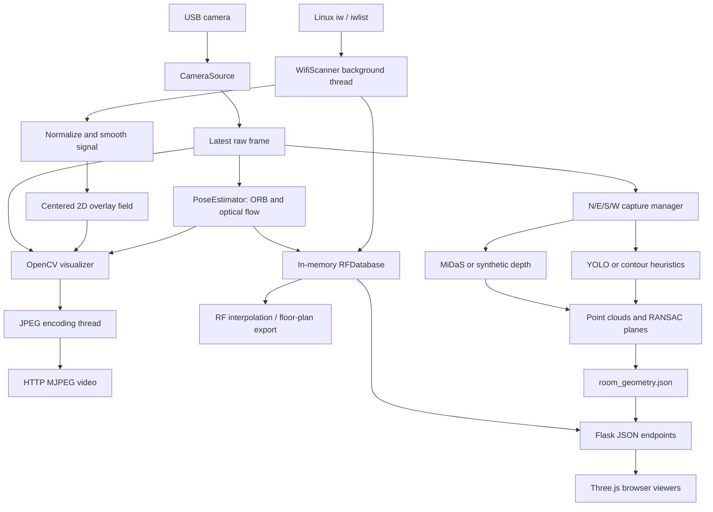

**EdgeRF 3D — explanation of the local project**

Reviewed 3 November 2026. This explanation describes the files in this checkout, including local changes already present when inspection began. Application source files were not edited.

The project combines WiFi site surveying, camera motion estimation, experimental room reconstruction, and browser visualization. The WiFi adapter measures RSSI at the device. The camera supplies images for motion tracking and scene estimation. Python joins those two streams, and browser pages draw the resulting samples and interpolated coverage maps.

**Coverage of this review**

The initial inventory opened and hashed 1,078 files across 174 directories, totaling 186,202,403 bytes (about 177.6 MiB), including `.git`, ignored research directories, compiled files, and empty directories. It classified 991 files as text and 87 as binary. These are snapshot counts; this review's generated files are excluded.

All text was read programmatically for indexing. The main application's modules, interfaces, algorithms, and viewer behavior received focused source review. This is not a line-by-line semantic audit of every bundled third-party library. Compiled libraries and Git object archives were inventoried and inspected as binary artifacts, rather than executed or decompiled. Serialized research data was not executed or loaded with pickle.

Every PNG/JPEG asset was decoded and visually inspected in contact sheets. The GIF was sampled across its 265 frames. The HDR lighting image was converted and viewed, and all nine PLY/OFF example meshes were parsed and visualized as projected vertex previews. The complete MP4 was decoded sequentially: 1,669 video frames, with 13 frames retained across its 55.63-second duration for visual inspection. Its AAC audio was not transcribed or assessed. Visual inspection does not mean every video frame was individually watched.

Companion artifacts:

- [Every original file, size, hash, preview, and Python symbols](FILE_CATALOGUE.md)
- [Every original directory and file path](tree.txt)
- [Machine-readable inventory](inventory.json)
- [Image/video metadata](media.json)
- [Source syntax checks and directory statistics](checks.json)
- [Complete route list](routes.json)
- [Still-image contact sheet 1](images_1.jpg), [sheet 2](images_2.jpg), [sheet 3](images_3.jpg)
- [Video contact sheet 1](video_1.jpg), [sheet 2](video_2.jpg)
- [All nine geometry previews](geometry_previews.jpg), [geometry metadata](geometry.json), and [HDR lighting-image preview](hdr_preview.png)
- [Directory-by-directory purpose ledger](DIRECTORY_GUIDE.md)

**What the system actually measures**

The radio returns a list of access points containing SSID, BSSID, RSSI in dBm, and frequency in MHz. A higher dBm value, such as -45 instead of -80, means stronger received signal. The camera does not measure RF direction or detect radio waves in individual pixels.

There are three related workflows in this checkout:

1. A live camera display with network labels, a signal bar, and a centered colored overlay.
2. A spatial survey: manually choose positions on a normalized room map or attach WiFi samples to visual-odometry coordinates.
3. An experimental scene workflow: capture N/E/S/W views, estimate depth and furniture, export room geometry, and display it with RF data.

These share modules but do not form one fully calibrated reconstruction and measurement system. In particular, manually positioned mapper samples and VO-based RF samples live in different stores.

**The running architecture**



`main.py` is the intended entry point. It parses options, reports the system, checks the camera, attempts one WiFi scan, and then starts `app.run_server()`. A failed camera check aborts `main.py`; a failed WiFi scan is logged and startup continues. Running `app.py` directly is slightly different: its server can continue with blank camera frames.

`app.py` constructs a shared `RuntimeContext`, starts the scanner, and starts a three-stage `StreamWorker`: capture, processing, and JPEG encoding. Each stage works with the newest available data rather than accumulating an unlimited video queue. Flask serves the dashboard, MJPEG stream, JSON APIs, heatmap PNGs, and exports.

Processing reads the current network list, computes an aggregate intensity, smooths it, updates the 2D overlay, and estimates camera motion. When a new scanner completion timestamp appears, it adds a sample to the manual mapper if a position is set, and to the 3D RF database if networks exist and pose confidence exceeds 0.1. Network measurements run much more slowly than camera frames, so they are reused between scans.

The transport implemented here is HTTP: MJPEG for video and repeated `fetch()` calls for metadata. The architecture image and README mention WebSockets, but the application does not implement a WebSocket server.

**Every main Python module**

| File | Responsibility and actual behavior |
|---|---|
| `main.py` | Startup checks and CLI: port, camera resolution, interface, scan interval, and visualization mode. Calls the server after readiness checks. |
| `config.py` | Central defaults for camera, scanning, signal normalization, mapper, survey, VO, RF database, interpolation, server, depth/detection models, scene output, and colors. |
| `app.py` | Application assembly, camera abstraction, threaded processing, embedded dashboard and legacy viewer HTML, 47 HTTP routes, exports, layout persistence, scene capture APIs, and IMU APIs. |
| `wifi_scanner.py` | Background managed-mode WiFi scans. Tries `iw`, `ap-force`, noninteractive sudo variants, and `iwlist`. Parses and sorts access points; retains old results after transient failures. |
| `signal_processor.py` | Maps -90..-30 dBm into 0..1; selects the strongest network; combines normalized intensities with `1 - product(1-intensity)`; smooths with an exponential moving average. The combined number is a display score, not calibrated total RF power. |
| `rf_field.py` | Generates the camera overlay: add a centered Gaussian stamp to a low-resolution grid, decay old values, clamp, and upscale. This is screen-space visualization. |
| `visualizer.py` | Renders heatmap, animated pulse, labels, or combined camera overlays with OpenCV. The accepted renderer modes are `heatmap`, `pulse`, `labels`, and `combined`. |
| `spatial_mapper.py` | Separate 2D manual-position map. Positions are normalized to 0..1. Adds Gaussian stamps and can save/load compressed NumPy snapshots. It accumulates a display field rather than storing a spatially averaged dBm estimate. |
| `guided_survey.py` | Creates a grid of survey points, optionally in a serpentine traversal. Stores manual captures, target indices, signal values, and timestamps; supports advancing and resetting. It does not verify the device physically reached each target. |
| `pose_estimator.py` | Monocular visual odometry: ORB feature detection, Lucas–Kanade tracking, essential-matrix RANSAC, relative-pose recovery, and accumulated rotation/translation. Exposes position, tracking status, feature count, and heuristic confidence. |
| `rf_database.py` | Thread-safe in-memory list of position-tagged records, one per discovered access point per accepted scan. Keeps at most 5,000 records by default, applies a displacement threshold, supports SSID/BSSID filters and CSV/JSON save/load helpers. No SQL database is involved. |
| `rf_interpolator.py` | IDW, Gaussian RBF with SciPy and IDW fallback, and a covariance-based method named kriging. Produces a 2D grid or a capped 3D grid. The current browser viewers calculate their own floor heatmaps rather than consuming the Python volumetric grid. |
| `room_reconstructor.py` | Builds a rectangular floor plan around the RF sample trajectory with a margin. AP markers are located at each SSID's strongest measured sample. Also contains conversion helpers for scene geometry. The trajectory bounding box is an estimate of survey extent, not observed walls. |
| `heatmap_3d_renderer.py` | Optional Matplotlib export: IDW floor colors, isometric walls, walk path, AP markers, and dBm colorbar, returned as PNG. Runs on demand. |
| `scene_capture.py` | Thread-safe capture state machine: idle, capturing, reconstructing, ready, failed. Saves directional JPGs and runs reconstruction in a background thread. Can reload saved geometry. Partial captures are accepted. |
| `depth_estimator.py` | Downloads/loads MiDaS ONNX with CPUExecutionProvider, preprocesses images, and rescales relative inverse-depth into an approximate range. Falls back to an edge/radial synthetic depth map when download or session loading fails. |
| `furniture_detector.py` | Downloads/loads YOLOv8n ONNX, letterboxes input, filters selected COCO furniture classes, applies confidence filtering and NMS. Returns no detections when the model is unavailable; the reconstructor has a separate contour fallback. |
| `scene_reconstructor.py` | Combines per-view depth and detections; back-projects points, rotates cardinal views, merges/downsamples clouds, fits planes, lifts/deduplicates furniture boxes, and exports JSON. Uses NumPy/OpenCV rather than an implemented Open3D TSDF pipeline. |
| `imu_reader.py` | Optional MPU-6500/9250-style I2C reader using smbus2. Calibrates gyro offsets, combines accelerometer and gyro for pitch/roll, integrates yaw, and exposes a threaded orientation API. Generates simulated rotation when hardware is absent. |
| `benchmark.py` | Measures camera/overlay/JPEG throughput, system CPU utilization, process memory, and scan latency. It does not benchmark the entire VO plus scene reconstruction pipeline. |
| `test_hardware.py` | Hardware diagnostic script: discovers video devices, tries v4l2-ctl, ffmpeg, and OpenCV capture paths, and checks WiFi scanning. It requires real Linux/Pi hardware to give meaningful readiness results. |

The core application's 21 Python files contain 10,719 lines, with a substantial part of `app.py` consisting of HTML/CSS/JavaScript strings.

**How the RF and spatial data flow**

A typical stored record has this shape:

```json
{
  "x": 1.2, "y": 0.5, "z": 0.1,
  "ssid": "ExampleNetwork", "bssid": "aa:bb:cc:dd:ee:ff",
  "dbm": -62.0, "freq": 2437, "timestamp": 1770000000.0
}
```

Those coordinates are whatever the visual odometry currently reports. Naming them meters does not establish metric accuracy. The default camera intrinsics are estimated, and `recoverPose()` translation direction is multiplied by a fixed scale factor for every successful update. There is no measured per-step translation magnitude, stereo baseline, depth-assisted scale recovery, loop closure, or joint IMU/vision state estimator.

The displacement gate defaults to 0.05 coordinate units. That value only corresponds to 5 cm if the coordinate system has a reliable meter scale, which this implementation does not establish automatically. Tracking confidence is based primarily on feature count and failures, not a calibrated pose uncertainty.

The database retains BSSIDs, but many viewer operations group by SSID. Multiple radios sharing one SSID can consequently be combined. A marker placed at the strongest sample means 'strongest sampled position'; it does not prove the router physically sits there.

IDW predicts each unsampled location from nearby sample values weighted approximately by inverse squared distance. Gaussian RBF provides a smooth alternative where SciPy is available. Both are estimates between observations; neither directly models wall materials, multipath, antenna orientation, interference, throughput, or CSI. There is no RF ray-tracing or electromagnetic propagation solver in the main application.

**The browser views**

| Page/file | What it provides |
|---|---|
| `/`, embedded in `app.py` | Live video, network list, signal/FPS metrics, pose status, RF database information, per-SSID RF heatmap, manual room mapper, named snapshots, guided grid survey, PNG/CSV/JSON downloads. |
| `/video` | HTTP multipart MJPEG stream of processed camera frames. |
| `/3dmap`, `threejs_viewer.html` | Three.js room editor and digital-twin display. Named room layouts can be saved to the server; users select an active room, view sample spheres/floor heatmaps, show AP pins/walk path, filter SSIDs, export, and enable IMU view rotation. |
| `/scene`, `scene_3d_viewer.html` | Capture/reconstruction controls and a room scene containing a bounding cuboid, available plane geometry, furniture boxes, RF data, walk path, and capture-direction markers. |
| `_build_3dmap_html()` in `app.py` | Legacy canvas-based 3D fallback, served if the external Three.js viewer file is absent. |

The room editor is not automatic room segmentation. It loads a default Living Room/Bedroom/Kitchen arrangement when no saved layout exists, and users edit dimensions. The browser associates samples with rooms using time intervals established when the user changes the active room. Room assignment state is held in browser memory; saved server layouts contain room geometry and IDs, not a complete persistent measurement session.

For the editor view, the current sample bounding box is normalized into the selected room. If the sample Z span is small, display height is computed from signal strength plus deterministic jitter. `/scene` also normalizes sample positions to its cuboid and derives point height from RSSI. These are visualization transforms: distances and heights in the resulting display are not direct metric measurements of RF propagation through a volume.

The scene viewer always creates a bounding cuboid even when plane estimates are sparse. Furniture is displayed as boxes, not detailed reconstructed furniture meshes. Both viewers obtain Three.js resources from a CDN; a fresh browser load therefore is not completely offline unless those resources are cached or vendored.

**The four-view scene pipeline**

1. The capture manager copies raw camera frames labeled N/E/S/W and writes `scene_images/shot_N.jpg`, etc. The labels are manually chosen directions, not independently verified compass headings.
2. MiDaS produces relative inverse depth. The wrapper independently normalizes each image's prediction, reverses it, and multiplies by the configured 5.0 scale. This gives an approximate visualization range, not calibrated physical depth.
3. YOLO predicts 2D object boxes. If no furniture boxes are produced, Canny edges and contours supply heuristic candidates labeled table/chair/furniture from dimensions and aspect ratio. The fallback confidence is fixed at 0.75; it is not a learned probability.
4. A guessed pinhole camera matrix back-projects depth to point clouds. Clouds are rotated by fixed cardinal angles and concatenated. This assumes compatible views from approximately the same location and correct headings; it does not solve camera translations or optimize multi-view registration.
5. A voxel filter reduces points. Iterative RANSAC attempts floor/ceiling/wall planes; cloud bounds determine room dimensions, with fallback minimum sizes. Missing floor/ceiling planes can be synthesized.
6. Furniture boxes are lifted with depth and merged when nearby same-label candidates appear across views.
7. The result is saved to `scene_output/room_geometry.json`; the API attaches current RF data for rendering.

`SCENE_POINT_CLOUD_FILE` names a PLY output in configuration, but the active save method writes geometry JSON. The comments mention Open3D/TSDF, while the implementation is direct rotation, concatenation, NumPy voxel filtering, and RANSAC.

The YOLO lifting path, contour fallback, wall planes, VO data, and browser display use differing coordinate assumptions and offsets. They are not registered through one common calibrated transform. This matters when interpreting furniture placement or claiming all data occupies the same measured world frame.

**The two bundled research projects**

The root application imports its own lightweight depth/furniture/reconstruction modules. It does not import and execute these research frameworks. Their presence provides reference code and demonstrations, not proof that the Pi application runs their full algorithms.

`DeepPanoContext(github-1)/DeepPanoContext-main/` contains 953 files. Its README describes the ICCV 2021 panoramic scene-understanding system. Its original environment targets Python 3.7, PyTorch 1.7, CUDA 10.1, Detectron2, iGibson, and numerous geometry/rendering dependencies. Its trained `out/` checkpoints and full training datasets are absent here.

| DPC directory/module | Purpose |
|---|---|
| `main.py`, `train.py`, `test.py`, epoch scripts | Separate research entry points for configured training/testing. |
| `configs/` | YAML experiment configurations, dataset classes/bins, and configuration loading/overrides. |
| `models/detector/` | Detectron2 dataset registration and detector training support. |
| `models/pano3d/` | HorizonNet layout, 3D box estimation, relation networks, scene graph convolution, losses, training, and evaluation. |
| `models/ldif/` | LIEN image/shape encoding and local deep implicit function decoding for reconstructed object shape. |
| `models/mgnet/` | Mesh generation network, template/edge sampling, training, losses, and mesh extraction. |
| `models/multi_view/` | Associative embeddings, correspondence/stitching, merging, and multi-view training/testing. |
| `models/total3d/` | Perspective-view layout/camera/scene support associated with the Total3D-style pipeline. |
| Shared `models/` files | Dataset/collation support, model registries, loss base classes, optimizers, metrics, trainers, testers, and ResNet modules. |
| `utils/` | Coordinate transforms, layout geometry, relation optimization, rendering, preprocessing, iGibson handling, mesh/image I/O, figures, and visualization. |
| `demo/input/`, `demo/output/` | Example panoramic room, serialized scene information, and detector/reconstruction result images. These are research demonstrations, not local WiFi survey measurements. |
| `images/` | Research teaser, animated pipeline diagram, and an HDR lighting asset. |
| `external/` | 837 files of supporting third-party implementations, summarized below. |

| External subtree | Why it exists |
|---|---|
| `cooperative_scene_parsing/` | SUNRGBD-oriented detection/evaluation and MATLAB visualization helpers, with metadata. |
| `Equirec2Perspec/` | Converts equirectangular panorama images into perspective views; includes street-scene examples. |
| `frustum_convnet/` | SUNRGBD evaluation-related helpers. |
| `HorizonNet/` | Panoramic room-layout network and layout postprocessing. |
| `ldif/` | Implicit-shape representation, inference/utilities, mesh conversion, and the large GAPS library subtree. |
| `ldif/gaps/apps/` | Native geometry/image/point-cloud conversion and viewing utilities. Each application folder is a separate tool, not an EdgeRF service. |
| `ldif/gaps/pkgs/` | Geometry, graphics, RGBD/surfel, numeric, image codec, and supporting native packages: R2Shapes, R3Shapes, R3Graphics, R3Surfels, RGBD, RNBasics, RNMath, JPEG, PNG, and GLUT support. |
| `ldif/gaps/docs/`, `makefiles/`, `vc/` | Native-library documentation, build rules, Visual Studio projects, and Windows support libraries. |
| `mesh_fusion/` | CPU/GPU fusion, marching cubes, offscreen rendering, Cython/native build bindings, example meshes, and screenshot. |
| `panoramic_object_detection/` | Panoramic detection geometry/spherical overlap helpers. |
| `PIFu/` | Supporting implicit-surface geometry/mesh code. |
| `py360convert/` | Cubemap/equirectangular/perspective conversions, package/build files, and visual examples. |
| `pyTorchChamferDistance/` | Native/CUDA extension for mesh/point-cloud distance calculations. |

`holistic_scene_parsing(github-2)/holistic_scene_parsing-master/` contains 26 files. Its README describes the ECCV 2018 analysis-by-synthesis approach: optimize a parse graph containing room layout, CAD objects, camera, and optional human context by comparing rendered depth, normals, and segmentation with image-derived cues.

| HSP files/folders | Purpose |
|---|---|
| `inference.py` | Main optimization, layout/object adjustment, support reasoning, likelihood/prior evaluation, and human-context inference. |
| `mcmc.py` | Markov-chain move acceptance support. |
| `pg.py` | Parse graph, layout, objects/proposals, camera, and activity-group data structures. |
| `camera.py` | Camera geometry and coordinate conversion helpers. |
| `object_loader.py` | CAD OBJ loading and mesh processing. |
| `sample_human.py` | Human skeleton/context sampling and interaction reasoning. |
| `visualize.py` | 2D/3D boxes, point clouds, cuboids, and skeleton plotting. |
| `config.py` | Research data paths and logger setup, including an original author's absolute dataset path. |
| `metadata_fine.csv` | CAD/object metadata used by the research pipeline; it is not an RF survey CSV. |
| `osmesa/` | Offscreen scene rendering, native objects/shared library, build files, and setup instructions. |
| `utils/plyfile.py` | PLY geometry reader/writer; `__init__.py` marks the package. |
| `doc/teaser.png` | Research method illustration. |
| `README.md`, `requirements.txt`, `LICENSE`, `.gitignore` | Research instructions, dependencies, licensing, and ignore rules. |

Several HSP source files use Python 2 print syntax, and their data/model prerequisites are not included. They do not run as-is under the inspected Python 3.12 interpreter. The research README also misspells `requirments.txt`, while the actual file is `requirements.txt`.

**Other root files and folders**

| Item | Meaning in this checkout |
|---|---|
| `README.md` | Project overview and setup guide. It mixes current Pi 5 intentions with older Pi Zero assumptions and contains stronger accuracy/performance claims than the local evidence supports. |
| `architecture.png` | Conceptual diagram featuring Pi Zero 2W, ORB-SLAM, WebSockets, and a polished multi-room heatmap. Several blocks are architectural intentions rather than the implemented transport/tracker. |
| `image.png` | Screenshot of a three-room interactive digital-twin display with colored samples. It is a screenshot artifact, not input geometry. |
| `result1.png`, `result2.png` | Earlier live camera dashboard screenshots, centered signal overlay, detected-network panel, and displayed FPS around 7.4–7.5. |
| `result4.png` | Camera dashboard plus a manually sampled 2D map showing 15 samples. |
| `Screenshot 2026-04-21 165500.png` | Standalone plotted WiFi heatmap with X/Y axes, likely from an earlier workflow. A screenshot alone does not establish its generating code or measurement calibration. |
| `3D_WIFI_render_result.mp4` | 1920×1200, 30 FPS H.264 screen recording with AAC audio; approximately 55.63 s and 35,045,436 bytes. Shows camera tracking, dashboard heatmaps, and orbiting the three-room display. |
| `Reset_Password.txt` | Copied headless Pi account/password-reset notes with placeholder credentials. It is unrelated to application execution; its OS-specific instructions were not validated during this review. |
| `models/README.md` | Documents expected MiDaS and YOLO ONNX files. Neither ONNX file is present in this checkout. |
| `scene_images/` | Empty initially; runtime destination for captured directional images. |
| `scene_output/` | Empty initially; runtime destination for reconstructed geometry. No saved real-room reconstruction was available to validate. |
| `__pycache__/` | Seven root CPython 3.10 bytecode cache files from earlier execution. Source files are the maintainable implementation. |
| `.gitignore` | Ignores results and the bundled research directories/data path. This explains why the research trees can exist locally without appearing as normal tracked application content. |
| `.git/` | 58 snapshot files: repository configuration, refs, logs, hooks/templates, index and compressed Git objects. These support version control and are not application modules. The pack was read and hashed, not expanded into a full historical-source audit. |
| `.dist/` | Empty before this review; now holds this report, catalogue, inspection scripts, media previews, and the downloaded video decoder under `project_review/`. |

The other binary/data artifacts belong to the research subtrees: MATLAB metadata, PLY/OFF meshes, implicit-network data, an HDR image, a pickle, DLL/LIB/SO/object files, and bytecode. Their exact paths, sizes and hashes are included in the catalogue. Their presence does not add equivalent functionality to the main application's runtime.

**Files created when the application runs**

These output names appear in source, but they were not all present in this checkout:

- `.mapper_snapshots/`: saved manual mapper state as compressed NumPy files.
- `room_layouts.json`: named room layouts and active layout; the code can migrate `room_layout.json`.
- `scene_images/shot_N.jpg`, `shot_E.jpg`, `shot_S.jpg`, `shot_W.jpg`: capture images.
- `scene_output/room_geometry.json`: scene geometry and metadata.
- Downloaded `models/midas_v21_small_256.onnx` and `models/yolov8n.onnx`.
- Downloadable RF/sample/survey CSV, JSON, and PNG reports.

The live RF database is in memory. Although save/load helpers and an RF snapshot-directory setting exist, normal server startup/shutdown does not automatically persist and restore the complete RF database. Closing the server therefore loses live samples unless exported separately.

**Configuration and running the intended application**

Current defaults target a Pi 5: camera 0 at 1280×720/30 requested FPS, `wlan0`, two-second delay between scans, 500 ORB features, 5,000 retained AP records, an 80×80 interpolation grid, and Flask on `0.0.0.0:5000`. Scan duration is additional to the configured delay. Requested camera FPS is not a measured throughput guarantee.

The intended deployment is Linux/Raspberry Pi OS with a USB/UVC camera and a usable WiFi interface. Windows can display results in a browser, but the scanning commands and V4L2 fallbacks are Linux-specific. An optional IMU uses I2C bus 1 at address 0x68 or 0x69.

The source imports these main third-party Python packages:

| Package | Used for |
|---|---|
| NumPy | Numeric grids, image/geometry arrays, interpolation. |
| OpenCV | Camera capture, features/flow/pose, image preprocessing, drawing and image encoding. |
| Flask | HTTP pages, JSON endpoints, streaming, and downloads. |
| SciPy | Optional faster distances/Gaussian RBF; IDW fallback exists. |
| psutil | Benchmark CPU/memory metrics. |
| Matplotlib | Optional static 3D PNG export. |
| ONNX Runtime | MiDaS/YOLO CPU inference. |
| smbus2 | Optional IMU I2C access. |

There is no root dependency lockfile or requirements file covering the complete application. The README's short install line omits ONNX Runtime, Matplotlib, and smbus2. The original research environments are separate and should not be treated as the Pi application's dependency definition.

Existing entry-point examples, to be run in a prepared Pi environment:

```bash
python test_hardware.py
python main.py --mode combined --interface wlan0 --resolution 1280x720 --port 5000
# Browser: http://<pi-address>:5000/ , /3dmap , /scene
python benchmark.py --duration 30
```

The README suggests `--mode mapping`. `main.py` accepts that argument, but `visualizer.py` does not implement that render mode and falls back to combined. Spatial mapping runs through the mapper/VO APIs independently of this mode string.

**Implementation limits that affect the explanation**

| Area | What should be understood |
|---|---|
| Metric localization | Fixed unit translation steps from monocular pose recovery do not establish physical distances. No full SLAM/loop-closure pipeline is present. |
| Room geometry | VO floor-plan bounds come from the traveled path; four-view reconstruction relies on approximate depth and fixed rotations. Neither is a surveyed architectural floor plan. |
| 3D RF coverage | Browser coordinate rescaling and RSSI-based point heights produce an illustrative 3D display. Vertical volume coverage has not been measured simply because samples appear at different heights. |
| Offline behavior | Inference is designed for CPU execution, but absent models trigger downloads/fallbacks, and browser Three.js assets use a CDN. |
| IMU integration | The IMU rotates the browser view. It is not fused into VO translation or camera reconstruction. Yaw is gyro-integrated; the code does not read a magnetometer or implement a full Mahony filter despite the introductory wording. |
| Demonstration evidence | The recording demonstrates interaction and visual tracking. It is not a ground-truth accuracy study or a Pi 5 throughput benchmark. |
| Scan freshness | On scan failure, old networks are retained while the completion timestamp advances. The processing loop can consequently record stale RSSI at a newer estimated position. |
| Session persistence | Room layouts and selected exports persist; the live RF database and browser room-assignment intervals do not constitute a durable full session. |
| Reconstruction reset | Cancel/reset changes manager state but does not stop a reconstruction thread already running. The worker may later publish a result. |
| Plane fitting memory | NumPy SVD is called on all plane inliers without `full_matrices=False`; this can allocate a very large square matrix for large clouds. No hardware memory/performance validation was performed. |
| Volumetric interpolation | The kriging-labeled method lacks an ordinary-kriging unbiasedness constraint. The 3D grid's documented axis order and returned shape also differ, and reducing grid dimensions leaves the reported scalar resolution unchanged. |

These observations are explanations and review findings. No corrective changes were applied to application code.

**What was verified**

All 21 root Python files parsed successfully with Python 3.12. Both standalone viewer scripts and both embedded page scripts passed `node --check`. Five older HSP Python files failed Python 3 parsing because of legacy print syntax.

The provided Python runtime has NumPy and Pillow, but not OpenCV, Flask, SciPy, ONNX Runtime, Matplotlib, or psutil. The full application, AI inference, real camera/WiFi scans, IMU hardware, and Pi benchmarks were therefore not run. Hardware accuracy and performance remain unverified.

Git status already showed changes to `threejs_viewer.html` and `__pycache__/app.cpython-310.pyc` when inspection began. They were preserved. The added review artifacts are under `.dist/project_review/`.
