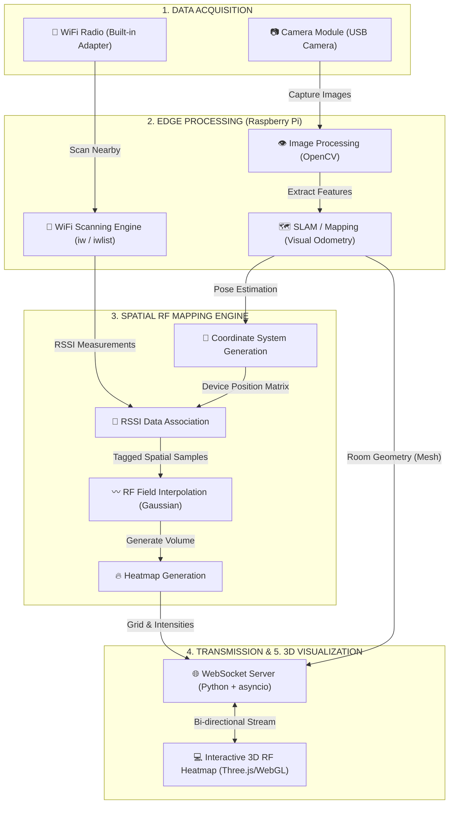
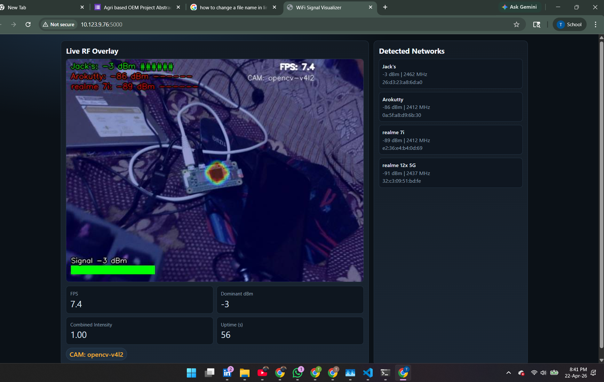
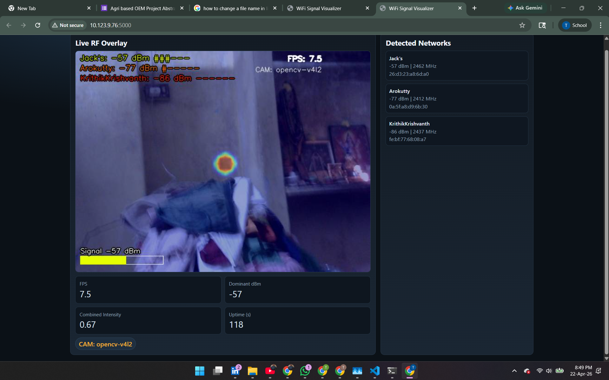

# EdgeRF — current runtime

EdgeRF collects WiFi RSSI at the device's location and associates measurements with camera-based motion estimates. It includes a responsive survey dashboard, interactive room viewers and an experimental four-image reconstruction pipeline.

**Engineering update · November 2026:** persistent SQLite surveys, scan freshness checks, camera-worker synchronization, bounded interpolation, reconstruction cancellation/timeouts, explicit model availability, full yaw/pitch/roll viewer sync, local Three.js assets, survey archives and automated regression tests are now implemented.

Start the hardware-free demo in this Windows workspace:

```powershell
.\.venv\Scripts\python.exe main.py --demo --host 127.0.0.1
```

Open **http://127.0.0.1:5000**. For a fresh installation, create a Python 3.12 virtual environment and install `requirements.txt`. Install `requirements-dev.txt` for tests, or `requirements-hardware.txt` for optional I2C and ONNX providers.

| Page | Purpose |
| --- | --- |
| `/` | Live dashboard, search/filter networks, pause/resume, new survey, archive downloads |
| `/3dmap` | Editable room layout, RF display, orientation sync and PNG capture |
| `/scene` | Four-shot experimental room reconstruction |
| `/legacy` | Existing manual mapper and guided-survey controls |
| `/healthz` | Camera/scanner/pipeline readiness, HTTP 200 or 503 |

Read **[Operations and setup](docs/OPERATIONS.md)** and **[Engineering changes and validation](docs/ENGINEERING_UPDATE.md)** for the authoritative current behavior.

**Measurement status:** this is a research prototype with improved software reliability, not a certified or metrically calibrated survey system. Monocular VO has unknown scale; the IMU controls view orientation and is not fused into position estimation. Four-view depth reconstruction is experimental, and RF-to-room registration is uncalibrated. Real Raspberry Pi throughput, sensor accuracy and long-running reliability still require hardware acceptance testing.

The original project narrative is retained below for historical context. Claims there about SLAM, metric accuracy, complete reconstruction or measured performance should be read against the limitations and current implementation above.

---

<div align="center">
  

  <h1>EdgeRF 3D: Spatial RF Propagation Mapping</h1>
  <p><b>3D Indoor WiFi Signal Mapping and Wireless Environment Reconstruction System.</b></p>

  

  <p>
    <a href="https://github.com/TharunBabu-05/EdgeRF-Vision-Real-Time-WiFi-Signal-Visualization-System-Camera-Based-Heat-Mapping"></a>
    
    
    
    
  </p>

  <p>
    
    
    
    
  </p>

  
</div>

---

> **EdgeRF 3D bridges the gap between physical space and invisible RF phenomena.**
> Transform a standard Raspberry Pi and USB camera into a spatial RF mapping engine that reconstructs indoor environments and plots WiFi signal propagation in 3D.

---

## 🚀 Overview
EdgeRF 3D is a highly advanced **Spatial RF Propagation Mapping and Holistic 3D Wireless Environment Reconstruction System**. Moving beyond simple 2D overlays, this system uses Computer Vision (Visual Odometry / SLAM) to understand room geometry, performs holistic 3D room reconstruction from 4 camera images, detects and places furniture in 3D, samples ambient WiFi signal strength (RSSI), and builds an interpolated 3D RF heatmap inside a real room model. Runs entirely on **Raspberry Pi 5 (16 GB RAM)** — no CUDA GPU required.

---

## 🧭 Why This Project Matters
Many WiFi visualizers place a fake colored hue over a camera feed based purely on local signal strength. **This is physically inaccurate**, as the RF source is rarely originating from where the camera points. 

**Our Solution:** 
Instead of treating the camera as an RF sensor, the camera is used for **Spatial Reconstruction**. Local RSSI measurements are anchored to actual physical coordinates as the device moves, allowing for **True Spatial RF Interpolation** and a scientifically valid representation of wireless propagation.

---

## ✨ Key Features
- **🏠 Holistic 3D Room Reconstruction:** 4-shot guided capture (N/E/S/W) → real walls, floor, ceiling + furniture boxes.
- **🛋️ Furniture Detection:** YOLOv8-nano ONNX detects chairs, sofas, beds, tables etc. and places 3D bounding boxes in the scene.
- **📐 Monocular Depth Estimation:** MiDaS-Small ONNX provides metric-scale depth from each camera image without LiDAR.
- **📡 Coordinate-Anchored RF Telemetry:** Maps real-time RSSI (dBm) readings to physical 3D coordinates inside the real room.
- **🎨 Interactive 3D Digital Twin:** Three.js viewer with real room geometry, furniture, RF heatmap, and walk path.
- **⚡ Edge-Optimized Pipeline:** CPU-only ONNX models tuned for Raspberry Pi 5 (no CUDA GPU required).
- **🔍 Multi-AP Tracking:** Tracks multiple SSIDs simultaneously with per-SSID filtering in the 3D viewer.

---

## 🧠 How It Works
1. **Data Acquisition:** The USB Camera captures the environment while the built-in WiFi radio scans nearby networks.
2. **Edge Processing (Visual Odometry):** Features and walls are extracted to reconstruct the room model and estimate device pose/position.
3. **Spatial RF Mapping Engine:** RSSI values are tagged with spatial coordinates. An interpolation model (Gaussian) creates a continuous RF heat distribution.
4. **Data Transmission:** Processed 3D coordinates and heatmap grids are packaged and streamed via WebSockets.
5. **Interactive Visualization:** A web client renders the reconstructed room and overlaid RF field in 3D (WebGL / Three.js).

---

## 🏗️ Architecture


> **Diagram legend:** The highly decoupled edge pipeline enables synchronous processing of vision and RF data, merged at the spatial engine level.

---

## 🛠️ Tech Stack
| Domain | Tech |
|---|---|
| Core Processing |   |
| Spatial / Vision |   |
| Telemetry |  |
| Web / Streaming |   |
| 3D Client |  |

---

## 🎬 Demo / GIFs
<div align="center">
  
  <br />
  
</div>

---

## 📸 Results / Architecture Flow
<div align="center">
  
  
</div>

---

## ⚙️ Installation Guide
### 1) Clone
```bash
git clone https://github.com/TharunBabu-05/EdgeRF-Vision-Real-Time-WiFi-Signal-Visualization-System-Camera-Based-Heat-Mapping.git
cd EdgeRF-Vision-Real-Time-WiFi-Signal-Visualization-System-Camera-Based-Heat-Mapping
```

### 2) Create Virtual Environment
```bash
python -m venv .venv
source .venv/bin/activate
```

### 3) Install Dependencies
```bash
pip install numpy opencv-python flask psutil scipy
```

<details>
<summary><b>Raspberry Pi system packages (required)</b></summary>

```bash
sudo apt update
sudo apt install -y python3-opencv ffmpeg v4l-utils iw wireless-tools
```
</details>

---

## ▶️ Usage
### Start the Pipeline
```bash
python main.py --mode mapping
```

### Hardware Verification
```bash
python test_hardware.py
```

---

## 📊 Performance / Edge Capabilities
| Metric | Target | Notes |
|---|---|---|
| Spatial Update Hz | ≥ 5 Hz | Driven by SLAM / Vision pipeline |
| RF Sample Rate | ~ 0.5 - 1 Hz | Subprocess iw scanning limits |
| Interpolation Time| < 50ms | Highly optimized NumPy vectorized matrices |

---

## 🧪 Future Improvements / Roadmap
- **Full ORB-SLAM integration** for absolute millimeter-accurate 3D point cloud tracking.
- **Multiple Antenna / Multi-Agent mapping** for faster room coverage.
- **Channel State Information (CSI) extraction** rather than simple RSSI for true multipath analysis.
- **VR/AR Headset integration** for live overlay in real environments.

---

## 🧩 Comparison vs Existing Solutions
| Feature | EdgeRF 3D | Commercial AP Site Survey | Previous Overlay Approach |
|---|---|---|---|
| **Mapping Method** | Camera Spatial Tracking (Visual) | Manual Floorplan Clicks | Fake Live Video Filter |
| **Interpolation** | True 3D Volume | 2D Floorplan Projection | Screen-space Color Filter |
| **Portability** | Pocket-sized Edge Device | Laptop + specialized antennas | Smartphone/Pi |
| **Cost** | Under $30 | $1,000+ | Free |

---

## 🌍 Real-World Applications
- **Wireless Digital Twins:** Creating live simulated environments for enterprise IT teams.
- **Academic Research:** Signal propagation analysis in complex reflective indoor spaces.
- **Smart Homes / IoT:** Optimizing mesh node placements automatically.
- **Robotics:** Allowing autonomous rovers to path-find based on RF signal quality.

---

## 🧑‍💼 Recruiter-Friendly Highlights
- Engineered a complex **sensor fusion system** marrying Computer Vision and RF Telemetry.
- Transitioned product from a simple visualizer to a **valid scientific instrumentation tool**.
- Implemented **Spatial Data Interpolation** using advanced mathematical modeling across N-dimensional arrays.
- Overcame rigid hardware constraints on a 512MB RAM single-board computer using vectorized processing.

---

## 🤝 Contributing
Contributions are absolutely welcome, particularly in the SLAM / Visual Odometry space.

1. Fork the repo
2. Create a new branch (`feature/slam-integration`)
3. Commit your changes
4. Open a pull request

---

## 🙌 Acknowledgements
- OpenCV community for lightweight vision solutions.
- The fundamental principles of Visual Odometry and RF Propagation.
- Raspberry Pi Foundation.

---

## 📬 Contact / Author
- Author: Tharun Babu
- GitHub: https://github.com/TharunBabu-05

---

## 📈 GitHub Stats
<div align="center">
  
</div>

<div align="center">
  
</div>
